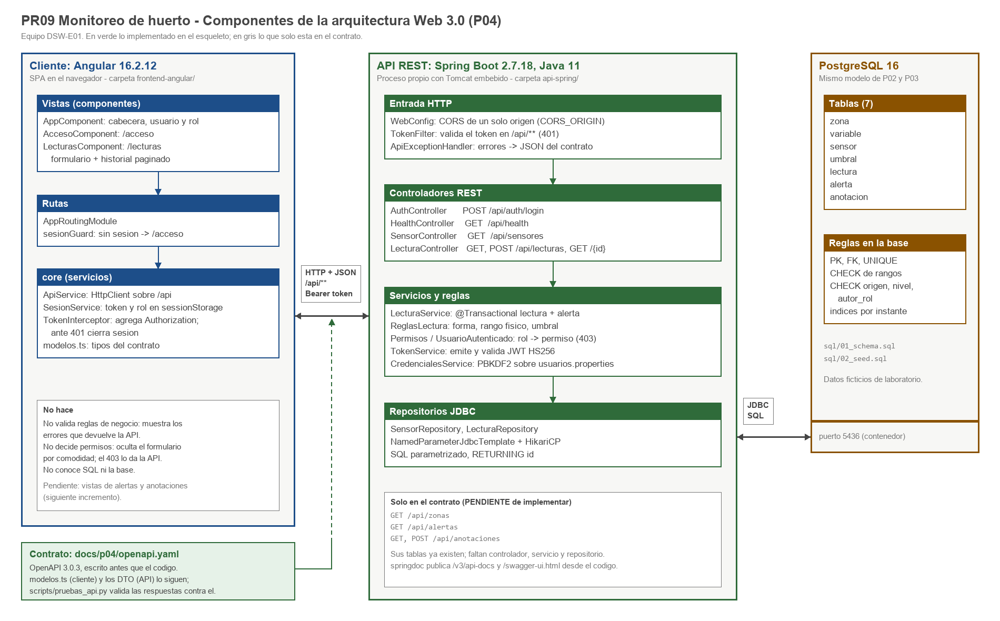
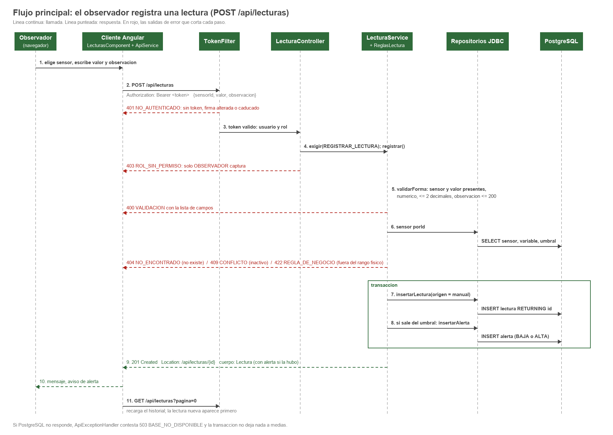
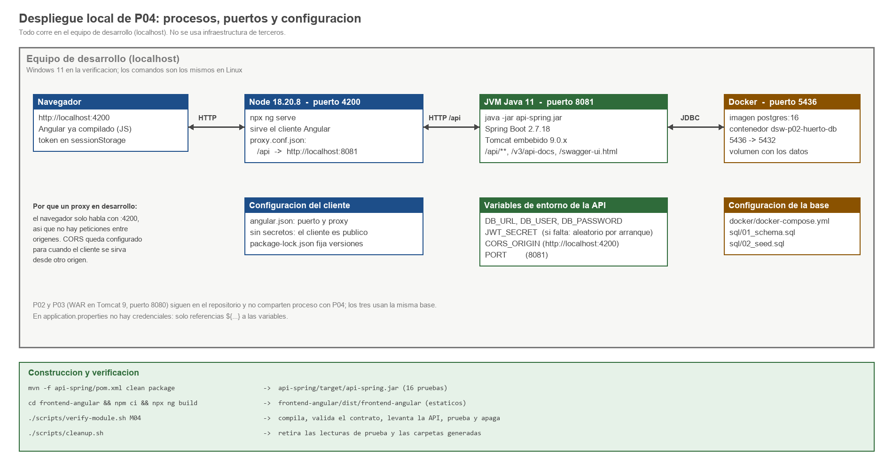

# P04 - Arquitectura Web 3.0 del PR09 (Angular + API Spring Boot + PostgreSQL)

Equipo DSW-E01. Commit de partida: `bf78beb` (cierre de P03). El proyecto sigue siendo el PR09, Monitoreo de huerto o
ambiente, con el mismo flujo principal (el observador registra una lectura y el sistema avisa si sale del umbral), los
mismos tres roles y la misma base de datos. Lo que cambia en P04 es la forma: la aplicacion deja de ser una sola pieza
que genera HTML en el servidor y se separa en un cliente y una API que se comunican por HTTP con JSON.

## 1. Componentes

| Capa | Carpeta | Tecnologia | Proceso y puerto |
|---|---|---|---|
| Cliente | `frontend-angular/` | Angular 16.2.12, TypeScript 5.1, RxJS 7.8 | navegador; en desarrollo lo sirve `ng serve` en el 4200 |
| API | `api-spring/` | Spring Boot 2.7.18, Java 11, Spring MVC, Spring JDBC, springdoc 1.7.0 | JVM con Tomcat embebido, puerto 8081 |
| Datos | `sql/`, `docker/` | PostgreSQL 16 | contenedor `dsw-p02-huerto-db`, puerto 5436 |
| Contrato | `docs/p04/openapi.yaml` | OpenAPI 3.0.3 | documento; lo cumplen el cliente y la API |

## 2. Responsabilidades

### Cliente Angular

| Componente | Responsabilidad | Lo que no hace |
|---|---|---|
| `AppComponent` | Cabecera con usuario y rol, boton de salida, navegacion. | - |
| `AccesoComponent` (`/acceso`) | Pide usuario y contrasena, llama a `POST /api/auth/login`, abre la sesion. | No compara contrasenas ni conoce los usuarios. |
| `LecturasComponent` (`/lecturas`) | Formulario de captura, historial paginado con filtro por procedencia, mensajes de exito, alerta y error. | No decide si el valor es valido: envia lo capturado y muestra la respuesta. |
| `sesionGuard` | Impide entrar a `/lecturas` sin sesion. | No es la seguridad real; la API responde 401 de todos modos. |
| `ApiService` | Unico punto que conoce las rutas de la API. | - |
| `SesionService` | Guarda token, usuario, rol y caducidad en `sessionStorage`; descarta sesiones caducadas. | No guarda la contrasena. |
| `TokenInterceptor` | Agrega `Authorization: Bearer` a las llamadas a `/api`; ante un 401 cierra la sesion y vuelve al acceso. | - |
| `modelos.ts` | Tipos TypeScript de los cuerpos del contrato. | - |

### API Spring Boot

| Componente | Responsabilidad |
|---|---|
| `WebConfig` | CORS para `/api/**` con un solo origen permitido; metadatos de OpenAPI. |
| `TokenFilter` | Exige token valido en `/api/**`, salvo `/api/health`, `/api/auth/login` y las peticiones `OPTIONS`. Responde 401 con el cuerpo de error del contrato. |
| `AuthController` | `POST /api/auth/login`: valida que vengan usuario y contrasena (400), comprueba credenciales (401) y emite el token. |
| `HealthController` | `GET /api/health`: 200 si la API llega a PostgreSQL, 503 si no. |
| `SensorController` | `GET /api/sensores`: catalogo con zona, variable, unidad, rango fisico y umbral. |
| `LecturaController` | `GET /api/lecturas`, `GET /api/lecturas/{id}`, `POST /api/lecturas`. Exige el permiso antes de llamar al servicio. |
| `LecturaService` | Orquesta el registro: forma, existencia y estado del sensor, rango fisico, insercion de lectura y alerta en una transaccion. |
| `ReglasLectura` | Reglas puras, sin Spring ni base: obligatorios, maximo dos decimales, rango fisico, nivel de alerta, texto de la alerta. |
| `Permisos`, `UsuarioAutenticado` | Tabla rol -> permisos tomada del acta; `exigir()` lanza 403. |
| `TokenService` | Emite y valida el token (JWT firmado con HMAC-SHA256). |
| `CredencialesService` | Compara la contrasena contra el hash PBKDF2 de `usuarios.properties`. |
| `SensorRepository`, `LecturaRepository` | SQL parametrizado con `NamedParameterJdbcTemplate`. No contienen reglas. |
| `ApiExceptionHandler` | Traduce excepciones al cuerpo `Error` del contrato; nunca envia trazas. |

### PostgreSQL

Guarda los datos y hace cumplir lo que no debe depender del codigo: claves, unicidad, rangos (`CHECK`), valores
permitidos de `origen`, `nivel` y `autor_rol`. El modelo no cambio (ver `docs/p04/modelo-datos.md`).

## 3. Flujo principal

El orden de las comprobaciones es deliberado: primero identidad (401), luego permiso (403), despues la forma de los
datos (400), luego lo que requiere consultar la base (404, 409, 422) y al final la escritura. Asi una peticion sin
permiso no llega a consultar PostgreSQL y una peticion mal formada no abre una transaccion.

## 4. Decisiones y alternativas

| # | Decision | Alternativas que revisamos | Por que elegimos esta |
|---|---|---|---|
| D1 | Cliente en **Angular 16.2.12** con modulos (`NgModule`) | React o Vue; Angular con componentes *standalone*; seguir con JSF | Angular es el framework fijado por la experiencia educativa para Web 3.0. Dentro de Angular, los modulos son la forma que usa el material del curso y la que genera el CLI 16 por omision; *standalone* funciona en la 16 pero nos obligaba a aprender dos cosas a la vez. JSF no sirve aqui porque mezcla vista y servidor, que es justo lo que P04 separa. |
| D2 | API en **Spring Boot 2.7.18** | Spring Boot 3; Servlets con JSON a mano; JAX-RS (Jersey) en el Tomcat de P03 | Spring Boot 3 exige Java 17 y espacio `jakarta`; el curso fija Java 11, y 2.7.18 es la ultima version de la linea que lo soporta. Hacer la API con servlets nos dejaba escribiendo a mano lo que Spring MVC ya resuelve (conversion JSON, manejo de errores, pruebas con MockMvc). |
| D3 | **Spring JDBC** (`NamedParameterJdbcTemplate`) en lugar de JPA | Spring Data JPA con Hibernate; JDBC puro como en P02/P03 | El SQL de P02 y P03 ya estaba escrito y probado; con JDBC lo reutilizamos casi igual y vemos exactamente que consulta se ejecuta. JPA nos habria pedido mapear siete entidades y cuidar que Hibernate no intentara modificar un esquema que comparten tres aplicaciones. Frente al JDBC puro, la plantilla de Spring quita el manejo manual de conexiones y nos da `@Transactional`. Costo: los `RowMapper` se escriben a mano. |
| D4 | **Token firmado** (JWT HS256) sin estado en el servidor | Sesion con cookie como en P03; Spring Security completo con OAuth2; Basic en cada peticion | Con cliente y API en origenes distintos, la cookie de sesion obliga a resolver `SameSite` y CSRF; el token en la cabecera evita ambos. Spring Security es la opcion correcta para produccion, pero para tres usuarios fijos agrega una cadena de filtros y proveedores que aqui no hacen falta; preferimos un filtro corto (`TokenFilter`, 64 lineas) que se puede leer completo. Basic mandaria la contrasena en cada peticion. Costo aceptado: un token emitido no se puede revocar antes de sus 30 minutos. |
| D5 | **Contrato primero**: `openapi.yaml` escrito a mano y springdoc como comprobacion | Generar el contrato solo desde el codigo; generar el codigo desde el contrato (openapi-generator) | Escribir el contrato antes nos obligo a decidir codigos de estado y cuerpos de error sin mirar la implementacion, y dejo definidos los recursos que todavia no programamos. springdoc queda como segunda fuente: la prueba 30 compara lo que publica el codigo contra el contrato. El generador de codigo produce clases que despues cuesta ajustar. Costo: hay que mantener dos documentos alineados; por eso la comparacion esta automatizada. |
| D6 | **Un repositorio, dos carpetas** (`api-spring/`, `frontend-angular/`) | Dos repositorios; modulo Maven multiproyecto que empaquete Angular dentro del jar | El equipo es de cuatro personas y la entrega es una; un repositorio mantiene juntos contrato, cliente, API y evidencia, y un commit puede cambiar los tres. Empaquetar Angular dentro del jar simplifica el despliegue, pero esconde la separacion que la practica pide mostrar. |
| D7 | **422** para valor fuera del rango fisico y **400** para datos mal formados | Responder 400 a todo, como en P02 | El cliente necesita distinguir "lo que enviaste no se puede leer" de "se leyo, pero el huerto no puede tener 150 C". Son causas distintas y el mensaje al usuario tambien lo es. |
| D8 | **Proxy de desarrollo** (`/api` -> 8081) y CORS de un solo origen | Llamar directo a `http://localhost:8081` desde el navegador; `allowedOrigins("*")` | Con el proxy el navegador solo habla con un origen y el cliente no lleva la URL de la API escrita. CORS queda configurado y probado para cuando se sirvan por separado. El comodin `*` permitiria que cualquier pagina llamara a la API. |
| D9 | El `valor` viaja como **numero JSON** y la API lo lee como `BigDecimal` | Enviarlo como texto; usar `double` | `double` convierte 24.555 en una aproximacion y la regla de "maximo dos decimales, sin redondear" dejaria de ser comprobable. Con `BigDecimal` la escala es exacta. |

La justificacion individual de cada integrante desarrolla una de estas decisiones con mas detalle (carpeta
`docs/p04/individual/`).

## 5. Seguridad basica

| Tema | Que se hizo | Donde |
|---|---|---|
| Autenticacion | Usuario y contrasena contra hash PBKDF2-HMAC-SHA256 (120 000 iteraciones, sal por usuario), comparacion en tiempo constante. | `CredencialesService`, `usuarios.properties` |
| Token | JWT HS256 con usuario, rol y caducidad de 30 minutos. El secreto llega por `JWT_SECRET`; si falta, se genera uno aleatorio en cada arranque (los tokens anteriores dejan de valer). | `TokenService` |
| Autorizacion | El rol sale del token, nunca del cuerpo de la peticion. `POST /api/lecturas` exige el permiso `REGISTRAR_LECTURA` (solo OBSERVADOR). | `Permisos`, `LecturaController` |
| CORS | Un solo origen (`CORS_ORIGIN`), metodos GET, POST y OPTIONS, cabeceras `Authorization`, `Content-Type`, `Accept`. | `WebConfig` |
| Inyeccion SQL | Todas las consultas usan parametros con nombre; no se concatena texto del usuario. | repositorios |
| Validacion | En el servidor siempre; el cliente solo ayuda. | `ReglasLectura`, `LecturaService` |
| Errores | Cuerpo uniforme sin trazas ni nombres de clases; `/api/health` publica solo "PostgreSQL 16.x". | `ApiExceptionHandler`, `HealthController` |
| Secretos | `application.properties` solo tiene referencias `${...}`; el repositorio no guarda contrasenas reales. | verificado en `verify-module.sh M04` |
| CSRF | No aplica al esquema elegido: el token viaja en una cabecera que el navegador no envia por si solo. | - |

Limites que conocemos: el token se guarda en `sessionStorage`, asi que un script inyectado en la pagina podria leerlo
(Angular escapa las salidas por omision y no usamos `innerHTML`); no hay HTTPS porque todo corre en `localhost`; no hay
limite de intentos de acceso. Los usuarios y contrasenas son ficticios, de laboratorio.

## 6. Despliegue

| Variable | Para que | Valor por omision |
|---|---|---|
| `DB_URL` | URL JDBC de PostgreSQL | sin valor por omision (la API no arranca sin ella) |
| `DB_USER`, `DB_PASSWORD` | Credenciales de la base | sin valor por omision |
| `JWT_SECRET` | Secreto de firma del token; con menos de 32 caracteres la API se niega a arrancar | aleatorio por arranque |
| `CORS_ORIGIN` | Origen permitido del cliente | `http://localhost:4200` |
| `PORT` | Puerto de la API | `8081` |

Los comandos estan en el README, seccion P04. La API usa el 8081 para no chocar con el Tomcat de P02/P03 en el 8080.

## 7. Que queda fuera de P04

El esqueleto implementa el flujo principal y lo necesario para probarlo de punta a punta. Quedan definidos en el
contrato, pero sin codigo: `GET /api/zonas`, `GET /api/alertas` y `GET/POST /api/anotaciones`, junto con sus vistas
en Angular. No se agregaron funciones que el acta no tenga (alta de sensores, edicion de umbrales, atencion de
alertas, graficas), ni el simulador IoT, que corresponde a Web 4.0.
