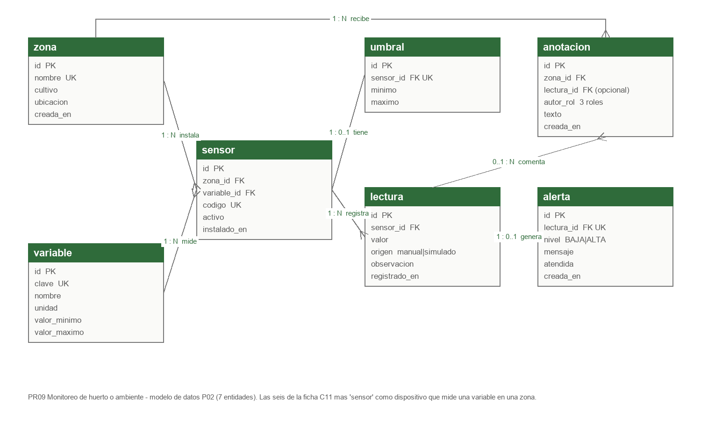

# P04 - Modelo de datos PostgreSQL y su relacion con la API

El modelo es el mismo de P02 y P03: siete tablas en PostgreSQL 16 creadas por `sql/01_schema.sql`. En P04 no se
agrego, quito ni modifico ninguna columna; la API lee y escribe sobre la base que ya usaban las versiones JSP y JSF.
La descripcion completa de cada tabla esta en `docs/modelo-datos.md`; aqui va el resumen y lo que es propio de P04:
como se convierte cada tabla en un recurso de la API.

## 1. Tablas

| Tabla | Columnas | Restricciones |
|---|---|---|
| `zona` | `id`, `nombre`, `cultivo`, `ubicacion`, `creada_en` | PK `id`; `nombre` unico; `ubicacion` obligatoria |
| `variable` | `id`, `clave`, `nombre`, `unidad`, `valor_minimo`, `valor_maximo` | PK; `clave` unica; `CHECK (valor_minimo < valor_maximo)` |
| `sensor` | `id`, `zona_id`, `variable_id`, `codigo`, `activo`, `instalado_en` | PK; FK a `zona` y `variable`; `codigo` unico |
| `umbral` | `id`, `sensor_id`, `minimo`, `maximo` | PK; FK unica a `sensor` (un umbral por sensor); `CHECK (minimo < maximo)` |
| `lectura` | `id`, `sensor_id`, `valor`, `origen`, `observacion`, `registrado_en` | PK; FK a `sensor`; `CHECK origen IN ('manual','simulado')`; indice `(sensor_id, registrado_en DESC)` |
| `alerta` | `id`, `lectura_id`, `nivel`, `mensaje`, `atendida`, `creada_en` | PK; FK unica a `lectura` (una alerta por lectura); `CHECK nivel IN ('BAJA','ALTA')` |
| `anotacion` | `id`, `zona_id`, `lectura_id`, `autor_rol`, `texto`, `creada_en` | PK; FK a `zona`; FK opcional a `lectura`; `CHECK autor_rol` con los tres roles; `CHECK` de texto minimo 3 |

Tipos: identificadores `BIGINT GENERATED ALWAYS AS IDENTITY`; valores `NUMERIC(10,2)`; instantes `TIMESTAMPTZ`.

## 2. Relaciones

| Relacion | Cardinalidad | Al borrar el padre |
|---|---|---|
| zona - sensor | 1 a muchos | `CASCADE` |
| variable - sensor | 1 a muchos | se impide (sin `CASCADE`) |
| sensor - umbral | 1 a 0..1 | `CASCADE` |
| sensor - lectura | 1 a muchos | `CASCADE` |
| lectura - alerta | 1 a 0..1 | `CASCADE` |
| zona - anotacion | 1 a muchos | `CASCADE` |
| lectura - anotacion | 0..1 a muchos | `SET NULL` |

## 3. De tabla a recurso

La API no expone las tablas una por una. Un recurso junta lo que el cliente necesita en una sola respuesta, para que
Angular no tenga que hacer tres llamadas y cruzar identificadores.

| Recurso (esquema del contrato) | Tablas que lo forman | Campo del JSON <- columna |
|---|---|---|
| `Sensor` | `sensor` + `zona` + `variable` + `umbral` (LEFT JOIN) | `codigo` <- `sensor.codigo`; `zona` <- `zona.nombre`; `variable` <- `variable.nombre`; `unidad` <- `variable.unidad`; `rangoFisicoMinimo/Maximo` <- `variable.valor_minimo/valor_maximo`; `umbralMinimo/Maximo` <- `umbral.minimo/maximo` |
| `Lectura` | `lectura` + `sensor` + `zona` + `variable` + `alerta` (LEFT JOIN) | `valor`, `origen`, `observacion`, `registradoEn` <- `lectura`; `sensorCodigo`, `zona`, `variable`, `unidad` <- joins; `alerta{nivel, mensaje}` <- `alerta` |
| `NuevaLectura` (entrada) | `lectura` | `sensorId` -> `sensor_id`; `valor` -> `valor`; `observacion` -> `observacion`. `origen` no se acepta: la API escribe `manual`. `registrado_en` lo pone PostgreSQL. |
| `Zona` (solo contrato) | `zona` | directo |
| `Alerta` (solo contrato) | `alerta` + `lectura` + `sensor` + `zona` + `variable` | directo mas joins |
| `Anotacion`, `NuevaAnotacion` (solo contrato) | `anotacion` + `zona` | `autorRol` <- `autor_rol`, que la API toma del token |

Convenciones: columnas en `snake_case`, campos JSON en `camelCase`; `NUMERIC(10,2)` viaja como numero JSON con dos
decimales (`25.50`) y en Java es `BigDecimal`; `TIMESTAMPTZ` viaja como texto ISO-8601 en UTC
(`2026-09-29T18:27:50.587461Z`) y el cliente lo muestra en hora local.

## 4. Donde vive cada regla

| Regla | En la API | En PostgreSQL |
|---|---|---|
| Sensor obligatorio y existente | `ReglasLectura`, `LecturaService` (400, 404) | FK `lectura.sensor_id` |
| Sensor activo | `LecturaService` (409) | - |
| Valor numerico con maximo 2 decimales | `ReglasLectura` (400) | `NUMERIC(10,2)` redondearia; por eso se valida antes |
| Valor dentro del rango fisico de la variable | `ReglasLectura` (422) | el rango esta en `variable`; la comparacion la hace la API |
| Alerta si sale del umbral, limites incluidos | `ReglasLectura.nivelAlerta` | `CHECK nivel`; una alerta por lectura (`UNIQUE`) |
| Lectura y alerta juntas o ninguna | `@Transactional` en `LecturaService` | transaccion |
| Procedencia | la API escribe `manual` | `CHECK origen` |
| Observacion de hasta 200 caracteres | `ReglasLectura` (400) | `VARCHAR(200)` |

Las reglas estan en los dos lados a proposito: la API da el mensaje claro y el codigo de estado; la base garantiza
que el dato quede bien aunque entre por otro camino (las aplicaciones de P02 y P03 escriben en las mismas tablas).

## 5. Lo que no se modelo

No hay tabla de usuarios. Los tres usuarios de laboratorio estan en `usuarios.properties` con su hash; agregar la
tabla sacaria el modelo del limite de siete entidades que fijo el acta. Si en un incremento posterior se aprueba, el
cambio queda aislado en `CredencialesService`.

## 6. Comprobacion

`sql/03_consultas_verificacion.sql` lista tablas, conteos y el cruce lectura-alerta. `verify-module.sh M04` lo
ejecuta antes y despues de las pruebas: `evidencia/txt/08_postgres_antes.txt` y `evidencia/txt/12_postgres_despues.txt`.
