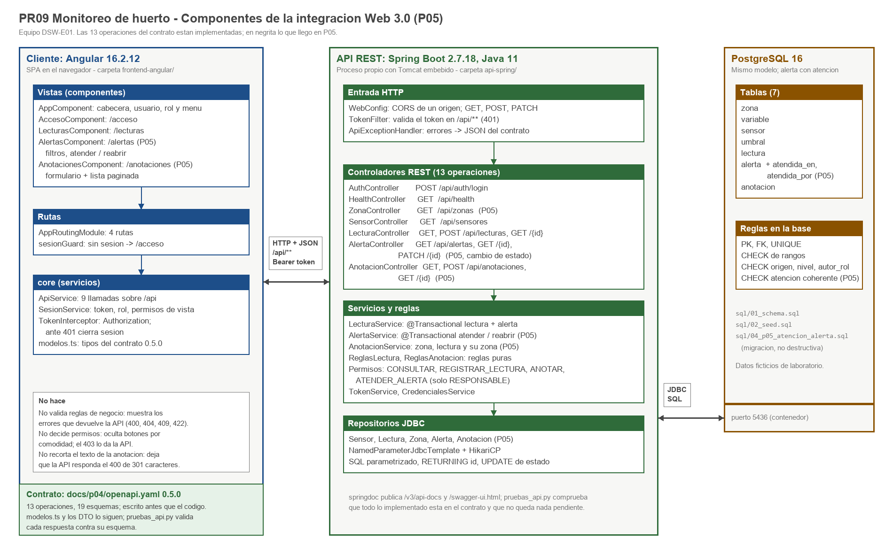
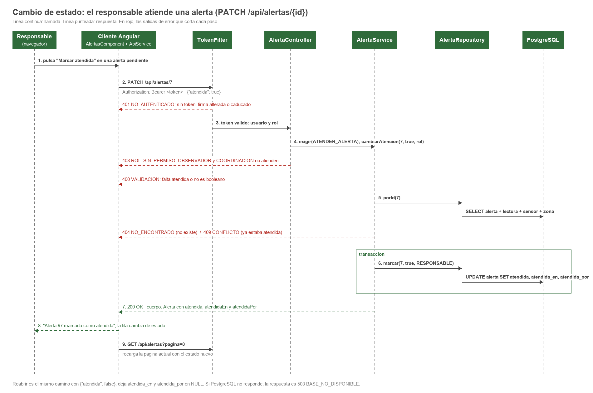
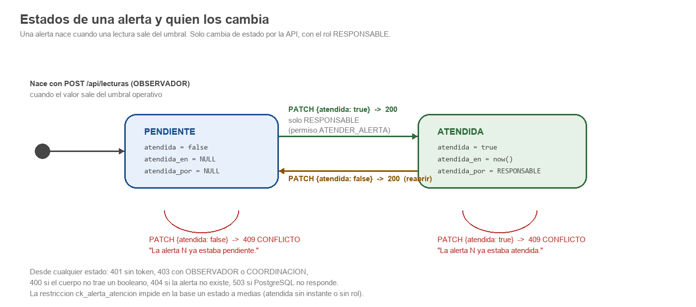
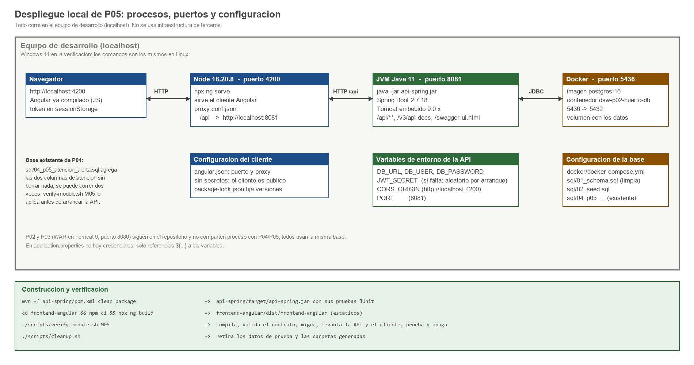
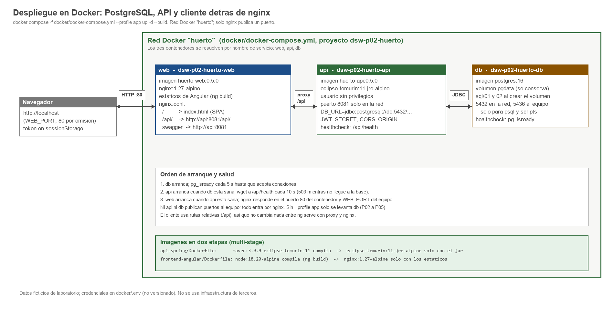

# P05 - Integracion Angular - Spring Boot - PostgreSQL (que cambia respecto a P04)

Equipo DSW-E01. Commit de partida: `9f398d6` (cierre de P04). La arquitectura es la que documentamos en
`docs/p04/arquitectura.md`: cliente Angular 16, API REST con Spring Boot 2.7.18 sobre Java 11 y PostgreSQL 16, con
el contrato OpenAPI como pieza central. En P05 no cambiamos esa forma; la completamos. Lo que en P04 estaba "solo en
el contrato" ahora tiene codigo, pruebas y recorrido de punta a punta, y la API ofrece lo que pide la consigna:
salud, consulta y **cambio de estado**.

## 1. Que se agrego



| Pieza | P04 | P05 |
|---|---|---|
| Contrato `docs/p04/openapi.yaml` | 0.4.0, 10 operaciones, 4 solo definidas | 0.5.0, 13 operaciones, todas implementadas |
| Zonas | solo contrato | `GET /api/zonas` |
| Alertas | solo contrato | `GET /api/alertas` con filtros y paginacion, `GET /api/alertas/{id}`, **`PATCH /api/alertas/{id}`** (atender o reabrir) |
| Anotaciones | solo contrato | `GET /api/anotaciones` paginado, `GET /api/anotaciones/{id}`, `POST /api/anotaciones` |
| Permisos | CONSULTAR, REGISTRAR_LECTURA, ANOTAR | mas `ATENDER_ALERTA`, solo para RESPONSABLE |
| Base | 7 tablas sin cambios | mismas 7 tablas; `alerta` gana `atendida_en` y `atendida_por` por una migracion no destructiva |
| Cliente | acceso y lecturas | mas `/alertas` (filtros, atender, reabrir) y `/anotaciones` (formulario y lista) |
| Pruebas de la API en marcha | 30 casos | los 30 de P04 mas los de zonas, alertas, cambio de estado y anotaciones |
| Recorrido en navegador | 12 casos | los 12 de P04 mas atencion de alertas, anotaciones y roles sin permiso |

Los numeros exactos de pruebas y casos, con su estado, estan en `verificacion.md`.

### Backend

Tres paquetes nuevos con la misma separacion que `lecturas/`: el controlador solo traduce HTTP, el servicio aplica
reglas y abre la transaccion, el repositorio tiene el SQL.

| Paquete | Clases | Que hace |
|---|---|---|
| `zonas` | `Zona`, `ZonaRepository`, `ZonaController` | `GET /api/zonas`, ordenadas por nombre |
| `alertas` | `Alerta`, `CambioAtencionRequest`, `AlertaRepository`, `AlertaService`, `AlertaController` | lista con filtros `nivel`, `atendida`, `zonaId` y paginacion; detalle; cambio de estado transaccional |
| `anotaciones` | `Anotacion`, `AnotacionRequest`, `ReglasAnotacion`, `AnotacionRepository`, `AnotacionService`, `AnotacionController` | lista paginada por zona; detalle; registro firmado con el rol del token |

`Permisos` suma `ATENDER_ALERTA`; `WebConfig` permite el metodo `PATCH` en CORS. Nada mas cambio en lo que ya
existia: `LecturaService`, `TokenFilter`, `ApiExceptionHandler` y los repositorios de P04 son los mismos.

### Frontend

| Pieza | Que hace |
|---|---|
| `AlertasComponent` (`/alertas`) | Tabla con nivel, estado y fecha; filtros por nivel y por atendida; botones "Marcar atendida" y "Reabrir" solo cuando el rol puede; para los otros roles, un aviso en lugar de los botones |
| `AnotacionesComponent` (`/anotaciones`) | Formulario con zona (de `/api/zonas`), lectura opcional y texto con contador; lista paginada con filtro por zona y el rol que firmo cada anotacion |
| `ApiService` | `zonas()`, `alertas()`, `cambiarAtencion()`, `anotaciones()`, `registrarAnotacion()` |
| `SesionService` | `puedeAtenderAlertas` (solo RESPONSABLE) y `puedeAnotar` |
| `modelos.ts` | Tipos `Zona`, `Alerta`, `PaginaAlertas`, `CambioAtencion`, `NuevaAnotacion`, `Anotacion`, `PaginaAnotaciones` |

El cliente sigue sin decidir reglas: oculta botones por comodidad, pero el 403 lo da la API, y el texto de la
anotacion no se recorta en el navegador para que el 400 de 301 caracteres llegue desde el servidor y se vea.

## 2. El cambio de estado



El responsable marca una alerta como atendida o la reabre. El servidor registra el instante y el rol; ninguno de los
dos viaja en el cuerpo. El orden de las comprobaciones es el mismo que en el registro de lecturas: identidad (401),
permiso (403), forma del cuerpo (400), existencia (404), estado actual (409) y al final la escritura.



## 3. Decisiones de P05 y alternativas

Siguen la numeracion de `docs/p04/arquitectura.md` (D1 a D9).

| # | Decision | Alternativas que revisamos | Por que elegimos esta |
|---|---|---|---|
| D10 | **`PATCH /api/alertas/{id}` con cuerpo `{atendida}`** para el cambio de estado | `PUT` con la alerta completa; `POST /api/alertas/{id}/atencion` como accion | Solo cambia un campo y lo demas lo decide el servidor; `PUT` obligaria a mandar la alerta entera y abriria la puerta a tocar campos que no deben cambiar; el `POST` de accion funciona pero no es un recurso. Reabrir es el mismo verbo con `false`, asi que no hay dos rutas para una cosa. |
| D11 | **409 cuando el estado pedido es el actual** | 200 sin cambios (idempotente) | Preferimos que el cliente sepa si su accion hizo algo: un doble clic o dos personas atendiendo la misma alerta reciben "ya estaba atendida" en lugar de un 200 que no cambio nada. Es el mismo uso que dimos a 409 en lecturas (sensor inactivo). Costo: el `PATCH` no es idempotente en sentido estricto; queda documentado en el contrato. |
| D12 | **Solo RESPONSABLE atiende alertas** | Responsable y coordinacion; los tres roles | El acta dice que el responsable "anota decisiones" sobre el huerto y que coordinacion "consulta". Atender una alerta es decidir que ya se actuo. Es una linea en `Permisos` si el equipo cambia de opinion; lo anotamos como ambiguedad del acta. De paso, el rol RESPONSABLE queda ejercido en la API, cosa que en P04 estaba NO_VERIFICADO. |
| D13 | **Columnas nuevas en `alerta`** (`atendida_en`, `atendida_por`) por **migracion no destructiva** | Tabla `atencion_alerta` aparte; no guardar quien ni cuando | Una tabla mas sacaria el modelo del limite de siete entidades del acta y es un 1 a 0..1 trivial. Sin instante ni rol, el cambio de estado no se puede auditar. `sql/04_p05_atencion_alerta.sql` se puede correr dos veces y no borra nada; `01_schema.sql` queda actualizado para instalaciones limpias. |
| D14 | **`GET /api/anotaciones` paginado** (cambio de contrato 0.4 -> 0.5) | Dejar la lista completa como en 0.4.0 | Lecturas y alertas ya eran paginadas; una tercera forma de listar obligaria al cliente a tratar cada recurso distinto. Como el contrato se escribio antes que el codigo, cambiarlo costo una version y una nota, no una migracion. |
| D15 | **422 si la lectura referida no pertenece a la zona** de la anotacion | No comprobarlo (P02 y P03 no lo hacian) | Una anotacion "sobre una lectura" de otra zona es un dato incoherente que la base no puede impedir (no hay FK compuesta). Es la misma categoria que "150 C": bien formado, pero imposible en el dominio. |
| D16 | **El cliente no recorta el texto a 300** | `maxlength` en el textarea (lo que hacia PrimeFaces en P03) | En P03 tuvimos que cubrir la regla de 301 caracteres solo con JUnit porque el componente no dejaba enviarla. Aqui el contador avisa, pero el envio llega a la API y el 400 se ve en pantalla; la regla queda probada de punta a punta. |
| D17 | **Pruebas de integracion contra la API real** con Python (`pruebas_api.py`, `recorrido_angular.py`) y pruebas de controlador con MockMvc | `@SpringBootTest` con Testcontainers; H2 en memoria | Testcontainers mete Docker dentro de Maven y H2 no se comporta como PostgreSQL en `RETURNING`, `TIMESTAMPTZ` y `CHECK`. Las pruebas Python corren contra el mismo PostgreSQL de desarrollo, cuentan filas antes y despues y validan cada cuerpo contra el contrato; MockMvc cubre codigos de estado y permisos sin base. |

## 4. Seguridad: que se suma a lo de P04

| Tema | Que se hizo en P05 |
|---|---|
| Autorizacion | Permiso nuevo `ATENDER_ALERTA` solo para RESPONSABLE; `POST /api/anotaciones` exige `ANOTAR` (los tres roles). El rol que firma la anotacion y el que atiende la alerta salen del token, nunca del cuerpo. |
| Validacion | `ReglasAnotacion` (clase pura, probada con JUnit): zona obligatoria, lectura opcional positiva, texto recortado de 3 a 300. `CambioAtencion` exige un booleano; un valor de otro tipo lo rechaza Jackson con 400. |
| CORS | Se agrega `PATCH` a los metodos permitidos; sigue siendo un solo origen. |
| Integridad | `ck_alerta_atencion` impide en la base una alerta atendida sin instante o sin rol, o pendiente con alguno de los dos. |
| Errores | Los mismos codigos y el mismo cuerpo `Error`; 409 y 422 ganan casos nuevos. Sin trazas. |

Los limites de P04 siguen igual: token en `sessionStorage` sin revocacion antes de los 30 minutos, sin HTTPS en el
laboratorio, sin limite de intentos de acceso. No usamos ningun servicio externo.

## 5. Despliegue



Nada cambia en procesos, puertos ni variables (`DB_URL`, `DB_USER`, `DB_PASSWORD`, `JWT_SECRET`, `CORS_ORIGIN`,
`PORT`). Lo unico nuevo es que una base creada en P04 necesita la migracion:

```bash
docker exec -i dsw-p02-huerto-db psql -U huerto_app -d huerto_db -v ON_ERROR_STOP=1 < sql/04_p05_atencion_alerta.sql
```

`verify-module.sh M05` la aplica antes de arrancar la API. Una base creada desde cero con `docker compose` ya trae las
columnas porque `01_schema.sql` esta actualizado. Los comandos completos estan en el README, seccion P05.

### 5.1 Todo en contenedores, detras de nginx



La segunda forma de correrlo es con los tres componentes en Docker, cada uno en su contenedor sobre la red `huerto`
(`docker compose -f docker/docker-compose.yml --profile app up -d --build`):

| Contenedor | Imagen (dos etapas) | Puerto |
|---|---|---|
| `db` | `postgres:16`, el mismo volumen `pgdata` de siempre | 5432 en la red; 5436 al equipo solo para `psql` y scripts |
| `api` | `api-spring/Dockerfile`: Maven compila -> `eclipse-temurin:11-jre-alpine` con el jar, usuario sin privilegios, `HEALTHCHECK` a `/api/health` | 8081 solo en la red |
| `web` | `frontend-angular/Dockerfile`: Node 18 hace `ng build` -> `nginx:1.27-alpine` con los estaticos y `nginx.conf` | `WEB_PORT` (80) al equipo |

nginx es la unica entrada: `/` sirve el cliente (las rutas del SPA caen en `index.html`), `/api/` se reenvia a
`http://api:8081/api/` y `/swagger-ui*` y `/v3/api-docs` a la API. Como el navegador solo habla con nginx, cliente y
API comparten origen: no hay peticiones entre origenes y CORS deja de intervenir. El cliente no cambia entre
`ng serve` y nginx porque siempre uso rutas relativas (`/api`). La API lee la base por el nombre de servicio
(`jdbc:postgresql://db:5432/huerto_db`); `compose` arranca cada contenedor cuando el anterior esta sano.

Por que asi y no de otra forma: una sola imagen con todo (jar que sirve los estaticos) es mas simple de desplegar,
pero esconde la separacion cliente-API que el curso pide mostrar; nginx como contenedor aparte del cliente obligaria a
un cuarto servicio sin ganancia, porque un `ng build` es solo archivos estaticos y nginx es la forma normal de
servirlos. Sin el perfil `app`, `docker compose up -d` sigue levantando solo la base, como en los incrementos
anteriores, asi que los scripts de verificacion no cambian.

## 6. Que queda fuera

Alta y edicion de zonas, sensores y umbrales desde la interfaz; graficas; simulador IoT (Web 4.0); usuarios en tabla.
Siguen sin estar en el alcance aprobado y no los agregamos.
